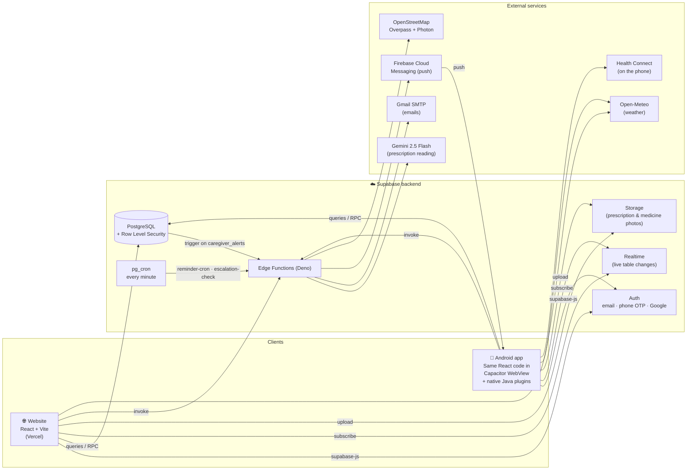
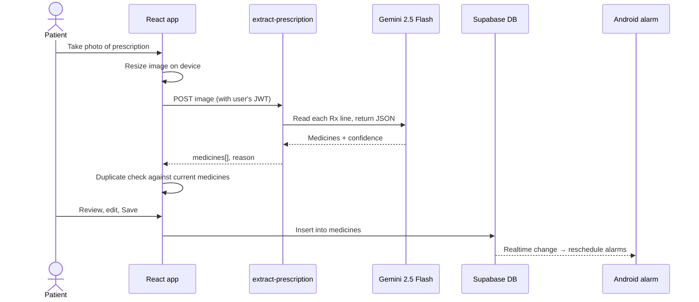
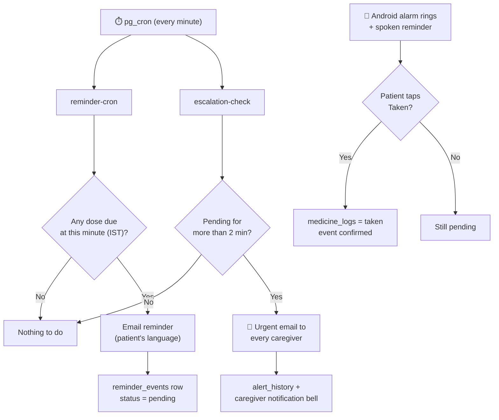
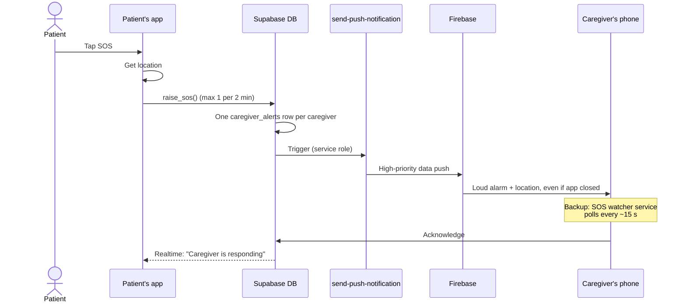
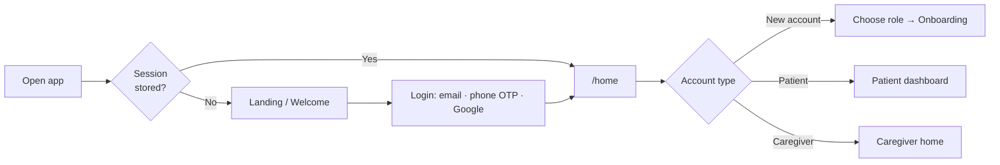
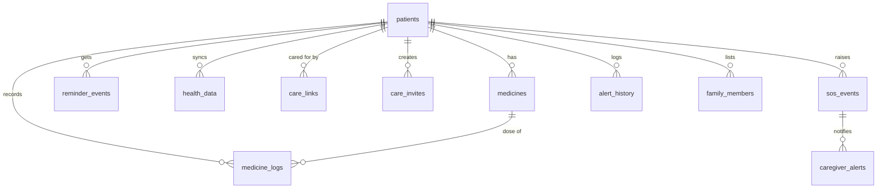

<div align="center">


# MediBuddy — Your Health Companion

**A medicine reminder and family-care app built for elderly patients and the people who look after them.**

Photograph a prescription, and MediBuddy sets the reminders. If a dose is missed, the family is told within minutes.
One tap on SOS rings every caregiver's phone, with the patient's location.

Website (React + Supabase, on Vercel) · Android app (Capacitor + native Java) · 8 Indian languages

</div>

---

## Contents

- [Why MediBuddy](#why-medibuddy)
- [How it helps elderly people](#how-it-helps-elderly-people)
- [Features](#features)
- [System architecture](#system-architecture)
- [How the frontend and backend work together](#how-the-frontend-and-backend-work-together)
- [Tech stack](#tech-stack)
- [Project structure](#project-structure)
- [Database](#database)
- [Getting started](#getting-started)
- [Deployment](#deployment)
- [Security and privacy](#security-and-privacy)

---

## Why MediBuddy

Older adults often take several medicines a day, each with its own timing. The problems are familiar to most families:

| Problem | What happens today |
|---|---|
| Doses are forgotten or taken twice | No reliable reminder, no record of what was taken |
| Handwritten prescriptions are hard to read | Shorthand like `1-0-1`, `BD`, `A/F` confuses patients |
| Family members live elsewhere | They find out about missed doses days later, if at all |
| Emergencies | The patient has to find a phone number and explain where they are |
| Language | Most health apps are English-only |

MediBuddy turns the prescription into a schedule, reminds the patient in their own language, records every dose, and keeps caregivers informed without the patient having to do anything extra.

---

## How it helps elderly people

- **Rings like an alarm clock, not a quiet notification.** On Android, a medicine reminder is a full-screen alarm at full volume. It works when the phone is locked or the app is closed, and comes back after a restart.
- **Speaks the reminder aloud.** The alarm says the medicine name and dose in the patient's language, so they don't need to read small text.
- **No typing needed to set up.** A photo of the prescription is enough. AI reads the medicines, dosages and timings; the patient (or a family member) just checks and saves.
- **Their own language.** The whole app works in English, Hindi, Telugu, Tamil, Kannada, Marathi, Bengali and Gujarati. Reminder and alert emails are sent in the patient's language too.
- **Simple, large controls.** Big buttons, a bottom navigation bar for one-handed use, and a single "Taken" button for each dose. Light and dark themes are available.
- **Protection against double doses.** If a new prescription contains a medicine that is already scheduled (e.g. the same Dolo 650), MediBuddy warns before adding it again.
- **Family is never out of the loop.** A missed dose alerts caregivers automatically. The patient doesn't have to call anyone.
- **Help in one tap.** The SOS button rings every caregiver's phone with a loud alarm and the patient's location, and also offers one-tap calls to 108 (ambulance), 104 (health helpline) and 112 (national emergency).
- **Care beyond medicines.** Daily weather with care tips for elders, step and fitness data from Health Connect, and a map of nearby pharmacies.

---

## Features

### 📸 Prescription scanning (AI)
- Upload a photo or use the camera; images are resized on the device before upload.
- Reads printed **and handwritten** prescriptions with Gemini 2.5 Flash, including Indian shorthand (`1-0-1`, `BD`, `TDS`, `A/F`, `x 5d`).
- Each medicine comes back with a confidence level. Unclear fields are left empty instead of guessed, and nothing that isn't on the photo is ever added.
- Everything is editable before saving.

### ⏰ Reminders and alarms
- Per-medicine schedule: once, twice or three times a day, as needed, or custom times.
- **Android:** native full-screen alarm with voice announcement, rescheduled automatically after a reboot and kept in sync with the database in real time.
- **Website and email:** a server-side job checks every minute and sends reminder emails in the patient's language.
- Doses are marked **Taken** or **Missed** and stored in a medicine log.

### 👨‍👩‍👧 Caregiver accounts
- Separate patient and caregiver logins; one person can be both and switch between the two views.
- Caregivers join through an invite code or link (`MB-XXXXXX`), with **view** or **manage** permission.
- A caregiver home lists each patient's doses for today: taken, missed and upcoming.
- A caregiver with manage permission can add and edit medicines for the patient.

### 🚨 Missed-dose escalation
- If a reminder is not confirmed within **2 minutes**, every linked caregiver gets an urgent email with the medicine, dose and scheduled time.
- Caregivers also see these alerts in the app's notification bell.

### 🆘 SOS emergency alert
- One tap alerts every caregiver: their phones ring with a loud alarm and show the patient's location, even if MediBuddy is closed (push notification plus a background watcher as a backup).
- The patient sees when a caregiver has acknowledged ("Ravi is responding").
- Built-in quick-dial for 108, 104 and 112.
- The database limits SOS to one every 2 minutes to prevent accidental floods.

### 📊 Health reports
- Adherence percentage, taken vs missed doses, weekly and 4-week summaries with charts.
- Export to PDF in the user's language (system print dialog on Android, browser print on the web).

### 🏃 Health data (Android)
- Steps and fitness data from **Health Connect** (Google Fit and others), with the phone's step sensor as a fallback.
- Synced to Supabase, so the website and caregivers see the same numbers.

### 💊 Nearby pharmacies
- Map of pharmacies within 2 / 5 / 10 / 15 km using OpenStreetMap, with phone numbers where listed.
- Search by city, area or PIN code.

### 🌦️ Weather and care tips
- Live local weather (Open-Meteo) with health tips suited to elders, such as hydration on hot days.

### 🌍 Languages and accessibility
- 8 languages: English, हिन्दी, తెలుగు, தமிழ், ಕನ್ನಡ, मराठी, বাংলা, ગુજરાતી.
- The language choice is saved in the profile and follows the user to any device.
- Light, dark and system themes; respects the "reduce motion" setting.

### 🔐 Sign-in
- Email and password, phone number with SMS OTP, or Google.
- Link several sign-in methods to one account, and merge a duplicate account created with a phone number.
- Sessions stay signed in and refresh automatically.

---

## System architecture



The website and the Android app share **one React codebase**. On Android, Capacitor wraps it in a WebView and adds native Java plugins for the things a browser can't do: exact alarms, text-to-speech, Health Connect, push notifications and a background SOS watcher.

All business data lives in **Supabase PostgreSQL**. Every table is protected by Row Level Security, so each request can only see what that user is allowed to see. Work that must happen when nobody has the app open (reminders, escalations, push) runs on the server in **Edge Functions**, started by `pg_cron` or database triggers.

### Edge functions

| Function | Started by | What it does |
|---|---|---|
| `extract-prescription` | App (signed-in user) | Sends the prescription photo to Gemini and returns structured medicines with confidence levels |
| `reminder-cron` | `pg_cron`, every minute | Finds doses due now (IST) and emails reminders in the patient's language |
| `escalation-check` | `pg_cron`, every minute | Finds reminders unconfirmed after 2 minutes and emails an urgent alert to caregivers |
| `send-medicine-email` | App | Confirmation, missed-dose and weekly-report emails |
| `send-push-notification` | Database trigger / app | Sends FCM push to all of a user's devices (SOS and caregiver alerts) |
| `nearby-pharmacies` | App | Proxies and caches OpenStreetMap pharmacy search and place geocoding |
| `merge-accounts` | App | Safely merges a duplicate phone-OTP account into the main account |

---

## How the frontend and backend work together

### 1. Prescription to reminders



### 2. Daily reminder, missed dose and escalation



### 3. SOS emergency



### 4. Sign-in and routing



A single `AuthContext` is the app's only source of truth for the session. Protected pages wait for it before deciding anything, so a token refresh or an OAuth redirect never logs the user out by mistake. On the website, Google returns to `/auth/callback`; on Android, it returns through the `com.medibuddy.app://login-callback` deep link.

---

## Tech stack

| Layer | Technology |
|---|---|
| Frontend | React 18, TypeScript, Vite, Tailwind CSS, shadcn/ui (Radix), Framer Motion |
| State and data | TanStack Query, React Context, Supabase Realtime |
| Charts and maps | Recharts, Leaflet with marker clustering |
| Mobile | Capacitor 8 (Android), native Java plugins for alarms, TTS, Health Connect, FCM, printing |
| Backend | Supabase: PostgreSQL, Auth, Storage, Realtime, Edge Functions (Deno), pg_cron, pg_net |
| AI | Google Gemini 2.5 Flash for prescription reading and email content |
| Notifications | Gmail SMTP (email), Firebase Cloud Messaging (push), Android exact alarms |
| External data | OpenStreetMap Overpass and Photon, Open-Meteo |
| Hosting | Vercel (website), APK (Android, min SDK 26) |
| Testing | Vitest, Testing Library |

---

## Project structure

```
├── src/
│   ├── pages/            # Screens: Dashboard, Medicines, Upload, Health, Care*, Auth, ...
│   ├── components/       # Layout, SOS button, dose list, charts, UI kit (shadcn)
│   ├── contexts/         # Auth, Care (patient/caregiver), Language, Theme, SOS
│   ├── hooks/            # Deep links, push, alarm sync, health sync, realtime
│   ├── lib/              # Business logic: schedule, SOS, pharmacies, reports, duplicate check
│   ├── i18n/locales/     # 8 languages
│   └── integrations/     # Supabase client and generated types
├── supabase/
│   ├── functions/        # 7 Edge Functions (Deno)
│   └── migrations/       # Database schema, RLS policies, cron jobs, triggers
├── android/              # Capacitor Android project + native Java plugins
│   └── app/src/main/java/com/medibuddy/app/
│       ├── alarm/        # Medicine alarm, voice, boot receiver, SOS watcher
│       ├── health/       # Health Connect + step sensor
│       └── push/         # FCM messaging service
└── vercel.json           # SPA rewrites + /auth/callback redirect
```

---

## Database



| Table | Purpose |
|---|---|
| `patients` | Profile, language, theme, caregiver email |
| `medicines` | Name, dosage, frequency, times, instructions, photo |
| `medicine_logs` | One row per dose: taken / missed |
| `reminder_events`, `reminder_send_logs` | Reminders sent and whether they were confirmed |
| `care_links`, `care_invites`, `care_invite_attempts` | Caregiver ↔ patient links, invite codes, rate limiting |
| `sos_events`, `caregiver_alerts`, `sos_watch_keys` | SOS alerts, per-caregiver delivery, background watcher keys |
| `alert_history`, `family_members` | Escalation history and family contacts |
| `health_data` | Daily steps and fitness data from Health Connect |
| `device_tokens` | FCM tokens for push |

---

## Getting started

### Prerequisites
- Node.js 18+ and npm
- A Supabase project (or access to the existing one)
- For Android: Android Studio, Android SDK (API 26+), JDK 21

### Run the website locally

```bash
git clone https://github.com/Lohith-L/medibuddy.git
cd medibuddy
npm install
```

Create `.env` in the project root:

```env
VITE_SUPABASE_URL=https://<project-ref>.supabase.co
VITE_SUPABASE_PUBLISHABLE_KEY=<anon / publishable key>
VITE_PUBLIC_SITE_URL=https://<your-vercel-domain>   # used for invite links from the app
```

```bash
npm run dev        # http://localhost:8080
npm test           # unit tests
npm run build      # production build in dist/
```

### Build the Android app

```bash
npm run build:mobile   # build the website and copy it into android/
npm run android        # open in Android Studio, then Run ▶
```

See [MOBILE_README.md](MOBILE_README.md) for signing, Firebase setup and troubleshooting.

### Backend setup

```bash
supabase link --project-ref <project-ref>
supabase db push                      # apply migrations (tables, RLS, cron, triggers)
supabase functions deploy --all       # deploy edge functions
```

Edge Function secrets (Supabase Dashboard → Edge Functions → Secrets):

| Secret | Used by |
|---|---|
| `LOVABLE_API_KEY` | `extract-prescription`, `send-medicine-email` (Gemini via AI gateway) |
| `GMAIL_USER`, `GMAIL_APP_PASSWORD` | Reminder, escalation and report emails |
| `FCM_SERVICE_ACCOUNT` | `send-push-notification` (Firebase service-account JSON) |
| `SITE_URL` | Links inside emails |

---

## Deployment

| Target | How |
|---|---|
| **Website** | Push to `main` → Vercel builds with `npm run build` and serves `dist/`. `vercel.json` rewrites all routes to the single-page app. |
| **Backend** | Migrations with `supabase db push`, functions with `supabase functions deploy`. |
| **Android** | `npm run build:mobile`, then build a signed APK / AAB in Android Studio. |

**Supabase Auth → URL Configuration** must list the website URL, `https://<your-domain>/auth/callback`, and `com.medibuddy.app://login-callback` as redirect URLs.

---

## Security and privacy

- **Row Level Security** on every table: patients see only their own data; caregivers see only patients who invited them, with view or manage permission.
- **Signed-in only** Edge Functions verify the user's JWT; server-only work uses the service role inside the function, never in the app.
- **Rate limits** in the database for SOS (1 per 2 minutes) and invite-code attempts.
- **Account merging** requires proof of both accounts (current session + a fresh SMS OTP).
- Prescription photos are stored in Supabase Storage and only sent to the AI model for reading.

---

<div align="center">

Built for **CodeFest Hyderabad** — so that no elder misses a dose and no family misses an emergency.

</div>
